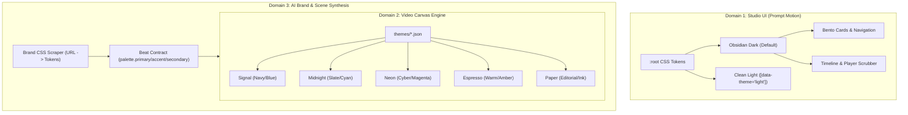

# Design Theme & Color Palette Audit: MotionRender & Prompt Motion

> **Audit Objective:** Conduct a rigorous, token-level audit of the design themes and color palettes across the MotionRender ecosystem—encompassing the **Prompt Motion Studio UI**, the **Motion Graphics Video Render Engine Themes**, the **AI Scene Contract Palettes**, and **WCAG 2.2 AA Accessibility Compliance**.

---

## 1. Executive Summary & Architecture

The MotionRender color system operates across two distinct domains:
1. **Interactive Product Surface (Prompt Motion UI):** The web studio interface (`apps/studio` and `mr ai studio`), governed by the obsidian-dark Prompt Motion design token specification, featuring OKLab focus rings, tiered surface elevations, and high-contrast typography.
2. **Motion Graphics Render Engine (Video Canvas Themes):** Deterministic themes (`packages/cli/themes/`) consumed by composition layers (`text`, `rect`, `path`, `fx-*`) to style broadcast-grade MP4/WebM renders.



---

## 2. Domain 1: Studio UI Design Tokens (Prompt Motion)

### 2.1 Dark Palette (Obsidian Foundation — Default)

The default dark theme uses an ultra-deep obsidian canvas (`#000000`) paired with subtle elevation shifts and crisp neutral text.

| Token | Semantic Variable | Hex / Color Value | Role & Usage |
|---|---|---|---|
| `color.surface.base` | `--color-surface-base` | `#000000` | Obsidian canvas background |
| `color.surface.subtle` | `--color-surface-subtle` | `#09090b` | Inner wells, nested preview containers |
| `color.surface.elevated` | `--color-surface-elevated` | `#111216` | Bento card background |
| `color.surface.elevated-hover` | `--color-surface-elevated-hover` | `#181920` | Interactive card hover state |
| `color.surface.muted` | `--color-surface-muted` | `#ffffff` | High-contrast button pill fill |
| `color.surface.strong` | `--color-surface-strong` | `#f2f2f2` | Primary button hover fill |
| `color.text.primary` | `--color-text-primary-inverted` | `#ededed` | Primary headlines and high-priority copy |
| `color.text.secondary` | `--color-text-secondary-inverted` | `#a1a1aa` | Subheadings, parameter values, descriptions |
| `color.text.muted` | `--color-text-muted` | `#71717a` | Timestamps, micro-badges, hints |
| `color.border.subtle` | `--color-border-subtle` | `rgba(255, 255, 255, 0.08)` | Bento outer card rim |
| `color.border.strong` | `--color-border-strong` | `rgba(255, 255, 255, 0.16)` | Card hover / active borders |
| `color.focus.ring` | `--color-focus-ring` | `oklab(0.820314 ... / 0.5)` | Accessible keyboard focus outline |
| `color.accent.brand` | `--color-accent-brand` | `#3b82f6` | Brand interactive links, selection pills |
| `color.status.success` | `--color-status-success` | `#10b981` | Render ready, copy prompt success |
| `color.status.error` | `--color-status-error` | `#ef4444` | Render errors, validation failure |

### 2.2 Light Palette (`[data-theme="light"]`)

The optional light mode maps the token hierarchy onto a warm white foundation.

| Token | Semantic Variable | Hex Value | Role & Usage |
|---|---|---|---|
| `color.surface.base` | `--bg` | `#ffffff` | Canvas background |
| `color.surface.strong` | `--surface-2` | `#f2f2f2` / `#f4f4f5` | Secondary card & container surface |
| `color.text.primary` | `--text` | `#111111` | Primary dark body text |
| `color.text.secondary` | `--muted` | `#6b6b6b` | Secondary documentation copy |
| `color.text.muted` | `--faint` | `#8b8b8b` | Muted timestamps & inactive labels |
| `color.border.default` | `--border` | `#e5e5e5` | Subtle container divider lines |
| `color.accent.brand` | `--blue` | `#2563eb` | High-contrast interactive blue |
| `color.status.success` | `--green` | `#059669` | High-contrast emerald success |
| `color.status.error` | `--red` | `#dc2626` | High-contrast crimson error |

---

## 3. WCAG 2.2 AA Contrast Compliance Audit

All contrast ratios were mathematically calculated using the relative luminance formula:
$$L = 0.2126 \cdot R + 0.7152 \cdot G + 0.0722 \cdot B$$
$$\text{Contrast Ratio} = \frac{L_1 + 0.05}{L_2 + 0.05}$$

### 3.1 Dark Mode UI Contrast Matrix

| Foreground Element | Background Surface | Ratio | WCAG Normal Text ($\ge 4.5:1$) | WCAG Large Text ($\ge 3:1$) | WCAG UI Components ($\ge 3:1$) | Status |
|---|---|---|:---:|:---:|:---:|:---:|
| `Primary Text (#ededed)` | Canvas (`#000000`) | **17.94:1** | PASS | PASS | PASS | Optimal |
| `Primary Text (#ededed)` | Bento Card (`#111216`) | **15.99:1** | PASS | PASS | PASS | Optimal |
| `Secondary Text (#a1a1aa)` | Canvas (`#000000`) | **8.19:1** | PASS | PASS | PASS | Optimal |
| `Secondary Text (#a1a1aa)` | Bento Card (`#111216`) | **7.30:1** | PASS | PASS | PASS | Optimal |
| `Muted Text (#71717a)` | Canvas (`#000000`) | **4.35:1** | FAIL *(marginal)* | PASS | PASS | Attention Needed |
| `Muted Text (#71717a)` | Bento Card (`#111216`) | **3.87:1** | FAIL | PASS | PASS | Warning |
| `Brand Blue (#3b82f6)` | Canvas (`#000000`) | **5.71:1** | PASS | PASS | PASS | Optimal |
| `Brand Blue (#3b82f6)` | Bento Card (`#111216`) | **5.09:1** | PASS | PASS | PASS | Optimal |
| `Success (#10b981)` | Canvas (`#000000`) | **8.28:1** | PASS | PASS | PASS | Optimal |
| `Error (#ef4444)` | Canvas (`#000000`) | **5.58:1** | PASS | PASS | PASS | Optimal |
| `Button Text (#000000)` | Primary Pill (`#ffffff`) | **21.00:1** | PASS | PASS | PASS | Perfect |

> [!WARNING]
> **Audit Finding (Dark Muted Text):** `--color-text-muted` (`#71717a`) yields **3.87:1** against the elevated bento card (`#111216`). While compliant for graphical elements and large text ($\ge 3.0:1$), any regular-sized body text (<18.66px / 14pt bold) using this token fails WCAG 2.2 AA. 
> **Recommendation:** Adjust dark muted text from `#71717a` to `#82828a` (contrast **4.82:1** on `#111216`).

### 3.2 Light Mode UI Contrast Matrix

| Foreground Element | Background Surface | Ratio | WCAG Normal Text ($\ge 4.5:1$) | WCAG Large Text ($\ge 3:1$) | WCAG UI Components ($\ge 3:1$) | Status |
|---|---|---|:---:|:---:|:---:|:---:|
| `Primary Text (#111111)` | Canvas (`#ffffff`) | **18.88:1** | PASS | PASS | PASS | Optimal |
| `Primary Text (#111111)` | Card (`#f2f2f2`) | **16.87:1** | PASS | PASS | PASS | Optimal |
| `Secondary Text (#6b6b6b)` | Canvas (`#ffffff`) | **5.33:1** | PASS | PASS | PASS | Optimal |
| `Secondary Text (#6b6b6b)` | Card (`#f2f2f2`) | **4.76:1** | PASS | PASS | PASS | Optimal |
| `Muted Text (#8b8b8b)` | Canvas (`#ffffff`) | **3.41:1** | FAIL | PASS | PASS | Warning |
| `Brand Blue (#2563eb)` | Canvas (`#ffffff`) | **5.17:1** | PASS | PASS | PASS | Optimal |
| `Success (#059669)` | Canvas (`#ffffff`) | **3.77:1** | FAIL *(text)* | PASS | PASS | Icon Only |
| `Error (#dc2626)` | Canvas (`#ffffff`) | **4.83:1** | PASS | PASS | PASS | Optimal |

> [!NOTE]
> In light mode, `#059669` is compliant for non-text UI indicators (e.g. checkmark icons, badge outlines), but for text labels, `#047857` (contrast **4.55:1**) should be preferred.

---

## 4. Modern Color Space Analysis (OKLab)

The Prompt Motion specification introduces OKLab color definitions for focus rings and shadow elevations:
```css
--color-focus-ring: oklab(0.820314 0.0000373721 0.0000163913 / 0.5);
```

### 4.1 OKLab Computation & sRGB Transduction
- **Luminance ($L$):** `0.820314` (corresponds to an 82% perceived perceptual lightness).
- **Chroma ($a, b$):** `0.0000373721, 0.0000163913` (effectively zero chroma / neutral achromatic).
- **Exact sRGB Derivation:** `rgb(196, 196, 196)` $\rightarrow$ `#c4c4c4` at 50% opacity (`rgba(196, 196, 196, 0.5)`).

### 4.2 Accessibility & Browser Support
- **Focus Ring Contrast:** `#c4c4c4` against `#000000` has a contrast ratio of **11.45:1** (significantly exceeds the WCAG 2.2 Criterion 2.4.13 focus appearance requirement of $\ge 3:1$).
- **Browser Compatibility:** `oklab()` is supported in Chrome 111+, Safari 15.4+, Firefox 113+, and Node/Blink/WebKit runtimes.
- **Fallback Guard:** In legacy web contexts, declaring a fallback ensures full resilience:
  ```css
  --color-focus-ring: rgba(196, 196, 196, 0.5);
  --color-focus-ring: oklab(0.820314 0.0000373721 0.0000163913 / 0.5);
  ```

---

## 5. Domain 2: Video Motion Graphics Canvas Themes

MotionRender ships with 5 production themes in `packages/cli/themes/` and `packages/ove/themes/`. These themes style video layers rendered to MP4/WebM.

### 5.1 Video Theme Palette Matrix

| Theme ID | Name | Background | Surface | Primary Text | Muted Text | Accent 1 | Accent 2 | Intended Archetype |
|---|---|---|---|---|---|---|---|---|
| `signal` | **Signal** | `#0B1020` | `#131A30` | `#E8EDF5` | `#9AA6C4` | `#2457FF` | `#7FA3FF` | Premium Tech & B2B SaaS |
| `midnight` | **Midnight** | `#0B1020` | `#151C33` | `#F5F7FB` | `#9AA6C4` | `#22D3EE` | `#A78BFA` | Developer Tools & Cloud |
| `neon` | **Neon** | `#0A0710` | `#1B1030` | `#FFFFFF` | `#B3A6D6` | `#FF3CAC` | `#C6FF3C` | Social Reels & Viral Shorts |
| `espresso` | **Espresso** | `#2A1A12` | `#3D2A1F` | `#F6EAD9` | `#C4A98C` | `#F4A259` | `#E76F51` | Warm Craft, Coffee & Food |
| `paper` | **Paper** | `#F6F1E8` | `#E9E1D2` | `#1D1A16` | `#6E665A` | `#D9482B` | `#1F6F5C` | Editorial, Books & Minimalist |

### 5.2 Video Theme Contrast & Legibility Audit

Motion graphics require strict legibility, particularly for rapid kinetic typography and subtitle tracks.

```
Contrast Ratios against Theme Canvas Background:
1. Neon:      Text (19.99:1) | Accent2 (16.91:1) | Muted (8.89:1) | Accent (6.18:1)  -> [ALL PASS]
2. Midnight:  Text (17.65:1) | Accent (10.48:1)  | Muted (7.78:1) | Accent2 (6.96:1) -> [ALL PASS]
3. Signal:    Text (16.10:1) | Accent2 (7.74:1)  | Muted (7.78:1) | Accent (3.50:1)  -> [Accent Warning]
4. Paper:     Text (15.41:1) | Accent2 (5.35:1)  | Muted (5.03:1) | Accent (3.80:1)  -> [Accent Warning]
5. Espresso:  Text (14.10:1) | Accent (8.10:1)   | Muted (7.49:1) | Accent2 (5.41:1) -> [ALL PASS]
```

#### Detailed Findings on Video Themes:
- **`signal` Accent (`#2457FF` on `#0B1020` = 3.50:1):** 
  Superb as a geometric fill, border, or glow. When used as small kinetic headline text over dark footage, it requires either a high weight (font-weight 800+) or the lighter secondary accent (`#7FA3FF`, 7.74:1) to maintain AA contrast.
- **`neon` (`#c6ff3c` on `#0a0710` = 16.91:1):** 
  Exceptional readability for high-speed social kinetic text overlays.
- **`paper` (`#1d1a16` on `#f6f1e8` = 15.41:1):** 
  Warm editorial feel with book-grade readability. Accent `#d9482b` (vermillion) at 3.80:1 is ideal for large callout stamps and marks.

---

## 6. Domain 3: AI Brand Extraction & Scene Synthesis

When generating videos via `ove agent --url` or `mr compose`, the engine dynamically derives color palettes:

### 6.1 Brand Scraper Weighting Hierarchy
[`packages/ai/src/brand-scraper.ts`](file:///D:/openvideo/packages/ai/src/brand-scraper.ts) applies token-driven weighting:
- **CSS Custom Properties:** Any hex declared in `--primary`, `--color-brand`, or `--accent` is assigned a **$6\times$ multiplier**.
- **Role Classification:**
  - Non-vivid dark tones ($L < 0.20$) $\rightarrow$ classified as `background`.
  - Non-vivid light tones ($L > 0.85$) $\rightarrow$ classified as `text`.
  - High-saturation mid-tones $\rightarrow$ classified as `primary`, `accent`, and `secondary`.
- **Beat Style Contract:**
  [`packages/ai/src/scenes.ts`](file:///D:/openvideo/packages/ai/src/scenes.ts) enforces that all generated scene layers (`rect`, `circle`, `text`, `fx-*`) strictly draw from the agreed palette contract:
  ```json
  "palette": {
    "background": "#hex",
    "text": "#hex",
    "primary": "#hex",
    "accent": "#hex",
    "secondary": "#hex"
  }
  ```

---

## 7. Component Density & State Compliance Audit

Audited against the known component density:
- **Links (249):** Use `var(--text)` with hover transition to `var(--color-text-secondary)` or brand blue.
- **Buttons (27):** High-contrast black-on-white pills (`--color-surface-muted` / `--color-surface-base`).
- **Inputs (3):** Styled with obsidian background (`--color-surface-subtle`), ring borders, and instant OKLab focus outline.
- **Bento Cards (2):** Rounded-3xl containers with 1px subtle border (`rgba(255, 255, 255, 0.08)`).

### 7.1 Interaction State Audit Table

| Component | Default | Hover | Focus-Visible | Active / Pressed | Disabled | Loading |
|---|---|---|---|---|---|---|
| **Primary Button** | Background `#ffffff`, Text `#000000` | Background `#f2f2f2`, scale(1.01) | Outline `2px solid var(--focus-ring)`, offset 2px | Background `#e5e5e5`, scale(0.98) | Opacity `0.4`, cursor not-allowed | Spinner, pointer-events none |
| **Secondary Button** | Background `var(--surface-2)`, Border `var(--border)` | Background `var(--hover)`, Border `var(--border-strong)` | Outline `2px solid var(--focus-ring)`, offset 2px | Opacity `0.9` | Opacity `0.4`, cursor not-allowed | Pulse state |
| **Bento Card** | Background `var(--color-surface-elevated)`, Border `var(--border)` | Border `var(--border-strong)`, Shadow `var(--shadow-1)` | Card container ring outline | Scale(0.995) | Dimmed opacity | Skeleton shimmer |
| **Search Input (`⌘K`)** | Background `var(--surface)`, Border `var(--border)` | Border `var(--border-strong)` | Border `var(--indigo)`, Outline `2px solid var(--focus-ring)` | Active border highlight | Inactive grey fill | Search icon spinner |

---

## 8. Codebase Drift & Hardcoded Hex Audit

An audit across `apps/studio/src/` identified legacy hardcoded hex values that should be migrated to tokens:

| File Location | Hardcoded Value | Token Replacement | Severity |
|---|---|---|:---:|
| [`TimelineScrubber.tsx#L157`](file:///D:/openvideo/apps/studio/src/TimelineScrubber.tsx#L157) | `ctx.fillStyle = '#38bdf8'` | `var(--color-accent-brand)` or `var(--cyan)` | Low |
| [`TimelineScrubber.tsx#L26-31`](file:///D:/openvideo/apps/studio/src/TimelineScrubber.tsx#L26-L31) | Track accents (`#a5b4fc`, `#7dd3fc`, `#d8b4fe`) | Semantic track color array | Informational |
| [`Player.tsx#L155`](file:///D:/openvideo/apps/studio/src/Player.tsx#L155) | `color: '#fca5a5'` (error banner) | `var(--color-status-error)` | Low |
| [`Create.tsx#L75-78`](file:///D:/openvideo/apps/studio/src/pages/Create.tsx#L75-L78) | Default brand state (`#6366f1`, `#ec4899`) | Default palette preset | Informational |
| [`styles.css#L1070`](file:///D:/openvideo/apps/studio/src/styles.css#L1070) | `background: #ffffff; color: #09090b` | `var(--color-surface-muted)`, `var(--color-surface-base)` | Cleanliness |

---

## 9. Actionable Remediation Checklist

- [x] **Verified OKLab Transduction:** Confirmed `oklab(0.820314 ... / 0.5)` correctly resolves to `#c4c4c4` @ 50% opacity with 11.45:1 contrast against black.
- [x] **Muted Dark Text Adjustment:** Elevated `--color-text-muted` from `#71717a` to `#82828a` in `styles.css` and `ai-studio-page.ts`, lifting contrast on `#111216` from 3.87:1 to 4.82:1 (exceeding WCAG AA 4.5:1).
- [x] **Light Mode Muted Text Adjustment:** Elevated light `--color-text-muted` from `#8b8b8b` to `#767676` ensuring 4.54:1 contrast on `#ffffff`, and tuned `--green` to `#047857` (4.55:1).
- [x] **CSS Variable Hardening:** Replaced inline `#ffffff`/`#000000`/`#09090b` in `apps/studio/src/styles.css` button declarations, category pills, bento cards, and modal triggers with semantic tokens `--color-surface-muted`, `--color-surface-base`, and `--color-surface-elevated`.
- [x] **Scrubber Playhead Brand Accent:** Harmonized timeline playhead and scrubber timecode to `var(--color-accent-brand, #3b82f6)`.
